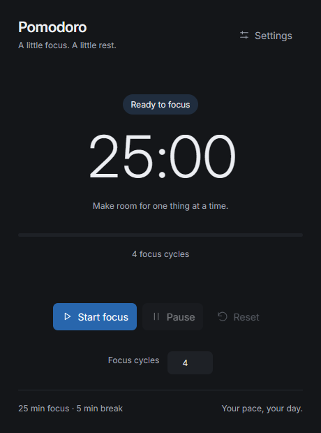
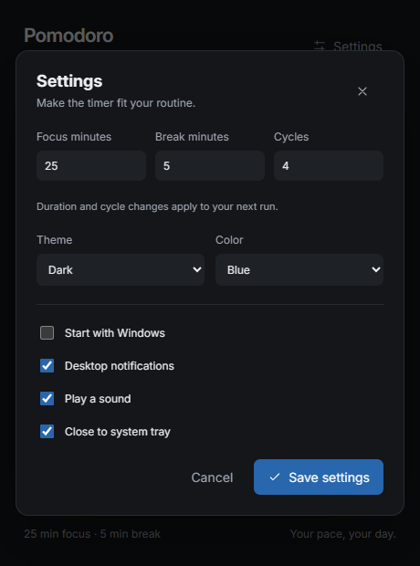

# Pomodoro Timer

**A little focus. A little rest.**

A project by [MiuBitz](https://miubitz.github.io/).

A quiet Windows Pomodoro app built with Tauri 2 and Rust. Choose one task, start the timer, and let focus sessions and breaks follow a simple rhythm.



[Download for Windows](https://github.com/MiuBitz/PomodoroTimer/raw/refs/heads/main/dist/PomodoroTimer.exe) · [How to use](#how-to-use) · [Build from source](#build-from-source)

## What it does

- Configurable focus sessions, breaks, and cycle count.
- Pause, resume, reset, and a clear completion message.
- Single-click tray opening and optional hidden startup with Windows.
- Independent notification and sound preferences.
- Live Light/Dark and Blue, Violet, Sage, or Amber previews.
- Local SVG icons and bundled Inter typography, matching DailyJournal's style.
- Rust owns the countdown, even while the window is hidden.
- Offline use with local settings; no account or cloud sync.

## Get started

1. Download `PomodoroTimer.exe` or use `dist/PomodoroTimer.exe` from this repository.
2. Put it in a folder you want to keep, then run it. Exit an older build from the tray before replacing it.
3. Open **Settings** to choose your routine and appearance.

The app is for **Windows x64** and requires [Microsoft Edge WebView2 Runtime](https://developer.microsoft.com/en-us/microsoft-edge/webview2/). Node.js is not needed to use or build the app.

## How to use

1. Choose your focus cycle count.
2. Click **Start focus**. Defaults are 25 minutes of focus and 5 minutes of rest.
3. Use **Pause** and **Resume** when you need to step away.
4. Breaks and the next focus session start automatically.
5. After the final break, the completion message stays visible. Choose **Start again** for another run or **Reset** to return to ready.

Each cycle includes a focus session and a break, including the final cycle. Reset ends the current run.

Closing the window keeps the timer running when **Close to system tray** is enabled. Click the tray icon once to reopen; right-click for **Open Pomodoro** and **Exit**. Exit, or closing with close-to-tray disabled, ends the run. Sessions are not restored after quitting.

## Settings



| Setting | Behavior |
| --- | --- |
| Focus minutes | 1–180 minutes; default 25. |
| Break minutes | 1–60 minutes; default 5. |
| Cycles | 1–99 focus/break cycles; default 4. |
| Theme and color | Preview immediately. Save keeps the choice; Cancel, close, or Escape restores the saved look. |
| Start with Windows | Launch hidden to the tray; off by default for a fresh installation. |
| Desktop notifications | Announce phase changes and completion. Windows notification settings may suppress alerts. |
| Play a sound | Controlled separately from desktop notifications. |
| Close to system tray | Keep the timer running when the window closes. |

Duration and cycle edits apply to the next run. An active run keeps its original values.

Portable notifications use Windows' built-in PowerShell notification host, which may appear as the sender. Keep the executable in a stable location for startup; re-save Settings if you move it.

## Local storage and timing

Preferences are stored at `%APPDATA%\PomodoroTimer\settings.json`. Valid settings from the previous C# version are accepted.

Monotonic deadlines prevent changes to the system clock from shifting a session. Delayed ticks catch up from scheduled boundaries rather than extending the run; only the latest transition is announced. Pausing preserves remaining time.

## Build from source

Requires Rust with the Windows MSVC toolchain, Microsoft C++ Build Tools with the **Desktop development with C++** workload and Windows SDK, and WebView2 to run the app.

```bat
build_windows.bat
```

The script builds locked dependencies and copies the release executable to `dist/PomodoroTimer.exe`. It respects `CARGO_TARGET_DIR` when set. The first build downloads Rust dependencies.

Development and checks:

```powershell
cargo run --locked
cargo fmt --check
cargo test --locked
```

Optional browser checks require Node.js, Playwright, and Microsoft Edge:

```powershell
node tests/frontend.cjs
node tests/native.cjs dist/PomodoroTimer.exe
node tests/website.cjs
```

Install Playwright locally or set `POMODORO_NODE_MODULES` to a directory containing it. Native checks use isolated settings under `target`. The website check serves its own temporary local preview.

The Windows GitHub Actions workflow checks formatting, runs Rust tests, builds the executable, and uploads a downloadable build artifact. To create an installer, compile `Installer/PomodoroTimer.iss` with Inno Setup after building.

## Project structure

```text
src/              Rust timer, settings, startup, and tray
ui/               App interface, local SVGs, and Inter font
Assets/           Windows application icon
capabilities/     Tauri permissions
dist/             Final PomodoroTimer.exe, included for direct downloads
docs/             Project webpage adapted from DailyJournal
tests/            Interface, native app, and website checks
.github/          Windows build workflow
```

## Project webpage and GitHub publishing

The `docs/` folder is copied from DailyJournal's website, with Pomodoro content, screenshots, and the same Font Awesome 6.5.2 CDN icons as DailyJournal. It needs no install or build step. Open `docs/index.html` or preview it locally:

```powershell
python -m http.server 8000 --directory docs
```

Publishing checklist:

1. Use the [MiuBitz/PomodoroTimer repository](https://github.com/MiuBitz/PomodoroTimer). Download and source links point here.
2. Push this folder's source and `dist/PomodoroTimer.exe` to the `main` branch. If you choose a different owner or repository name, update links in this README and `docs/index.html`.
3. In **Settings → Pages**, choose **Deploy from a branch**, **main**, and **/docs**. See [GitHub's publishing-source guide](https://docs.github.com/en/pages/getting-started-with-github-pages/configuring-a-publishing-source-for-your-github-pages-site).
4. For a tagged release, attach `dist/PomodoroTimer.exe` as the Windows download.

The repository and website are prepared locally. They have not been uploaded or published by this task.

## Third-party notices

See [THIRD_PARTY_NOTICES.md](THIRD_PARTY_NOTICES.md). Inter's SIL Open Font License is included alongside the app and website fonts.
